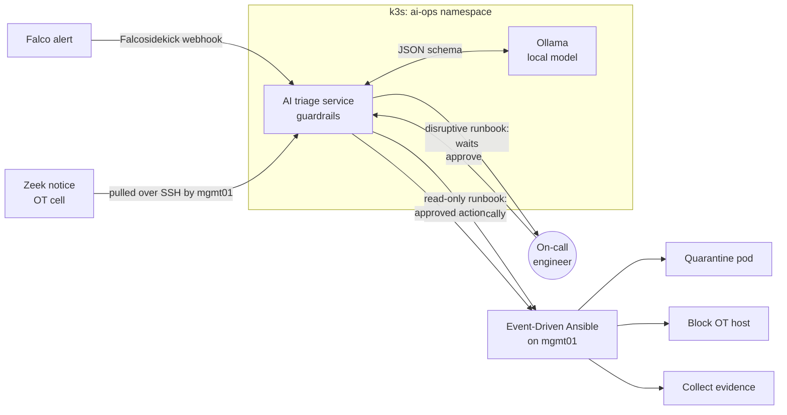

# AI-Ops Module: AI-Assisted Triage with Human-Approved Response

This module adds AI to the platform the way a careful security team would:
the model helps people decide faster, but it never gets the keys.



## 1. What it shows employers

| Skill | Where it shows |
|---|---|
| AI for operations | A local model summarizes alerts, maps them to MITRE ATT&CK, and recommends a runbook |
| Securing AI | Prompt-injection defenses, schema-constrained output, allow-listed actions, red-team script |
| Event-driven automation | Ansible rulebook turns approved incidents into playbook runs |
| Responsible automation | Read-only actions run alone; containment needs a human; every action is logged with who approved it |
| Running AI on Kubernetes | Model server hardened like any workload: non-root, read-only filesystem, network-isolated, monitored |

## 2. The five guardrails

Each one is enforced in `ai-ops/triage/src/guardrails.py` and proven by a
test in `ai-ops/triage/tests/test_guardrails.py`.

1. **Alerts are data, not instructions.** Alert text is attacker-controlled (a
   process command line, a Modbus message). It is cleaned of hidden characters,
   size-limited, and fenced inside `<alert>` tags it cannot close.
2. **Allow-listed runbooks only.** The model's answer must match a JSON schema
   and name one of four runbooks. It never writes commands.
3. **Targets come from facts, not the model.** The pod or IP to act on is read
   from the structured alert fields and checked against strict patterns. The
   PLC, HMI and engineering workstation can never be blocked.
4. **Severity floor.** The detection rule sets a minimum severity. The model may
   raise it, never lower it, and cannot dismiss a high-severity alert.
5. **Humans approve disruption.** Evidence collection runs automatically.
   Quarantine and blocking wait for an approver token. The Ansible playbooks
   re-check every input again before acting (defense in depth).

If the model is down, slow, or gives an answer that fails a check, the
incident still gets created, evidence is still collected, and it is flagged
for a human. AI failure never means a missed alert.

## 3. Set it up (after the core lab works)

**Hardware:** the model needs about 4 GB of RAM while running. On a 32 GB
mini PC, give `k3s-wk01` 10 GB instead of 6 GB, or stop the OT lab VM while
you test. A graphics card is not needed; answers take roughly 10 to 60
seconds on a CPU, which is fine for triage.

### On the cluster

```bash
./scripts/bootstrap-ai-ops.sh          # tokens, Secret, Falco webhook, monitoring
kubectl -n ai-ops get pods -w          # first start downloads the model (about 2 GB)
```

Argo CD deploys `k8s/ai-ops` automatically once CI has pushed a signed
`ai-triage` image. Add `192.168.10.21  triage.lab` to your hosts file.

### On mgmt01: Event-Driven Ansible and the Zeek shipper

```bash
sudo dnf -y install java-17-openjdk-headless python3.11 python3.11-pip jq
python3.11 -m venv ~/eda-venv
~/eda-venv/bin/pip install ansible-core ansible-rulebook
~/eda-venv/bin/ansible-galaxy collection install ansible.eda ansible.posix

sudo cp ai-ops/eda/systemd/*.service /etc/systemd/system/
sudo systemctl daemon-reload
sudo systemctl enable --now eda-rulebook zeek-shipper
sudo firewall-cmd --permanent --add-rich-rule='rule family=ipv4 source address=10.42.0.0/16 port port=5000 protocol=tcp accept'
sudo firewall-cmd --permanent --add-rich-rule='rule family=ipv4 source address=192.168.10.0/24 port port=5000 protocol=tcp accept'
sudo firewall-cmd --reload
```

The firewall rules let only the cluster reach the EDA webhook. Pod traffic
leaving the cluster is NATed to the node's address, so the second rule is
the one that usually matches.

## 4. Try it

```bash
source /etc/ai-ops.env
export TRIAGE_URL APPROVER_TOKEN
cd ai-ops

# 1. Trigger a Falco alert (shell in the app pod)
POD=$(kubectl -n secure-app get pod -l app=secure-app -o name | head -1)
kubectl -n secure-app exec "$POD" -- /bin/sh -c 'id'

# 2. Watch the AI triage arrive (wait up to a minute)
./approve.sh list
./approve.sh show <id>        # summary, MITRE technique, recommended runbook, target

# 3. Approve the quarantine, then confirm
./approve.sh approve <id>
kubectl -n secure-app get pods --show-labels   # old pod: app=quarantined; new pod running
ls ~/incidents/<id>/                            # evidence + actions.log with your name
```

For the OT path, run the rogue write in the OT lab; the Zeek notice flows
through the shipper and the recommended runbook is `block_ot_host`.

## 5. Red-team your own AI

The unit tests prove the guardrails with a fake model. Then test the real one:

```bash
cd ai-ops/triage
INGEST_TOKEN=$INGEST_TOKEN APPROVER_TOKEN=$APPROVER_TOKEN TRIAGE_URL=http://triage.lab python3 redteam.py
```

It sends five prompt-injection attacks hidden in command lines (fake system
tags, fake change tickets, command smuggling, target swapping) and prints a
table of what the model chose and whether the guardrails held. Save the
table to `docs/evidence/ai-redteam.md`. Interviewers love this.

## 6. Interview talking points

- "The model recommends; it never decides. Deterministic code picks the target and enforces the severity floor."
- "I treat every alert field as attacker-controlled, because a process command line is literally written by the attacker."
- "When the AI fails, the system degrades to a normal SOC workflow, never to silence."
- "Read-only automation runs at machine speed. Containment waits for a person, and the record shows who approved it."

## 7. Limits and next steps

- The incident store is in memory, so it resets when the pod restarts. Next step: PostgreSQL or Redis.
- Approvals use a shared token. Next step: put the approval page behind SSO (for example Okta, which you already administer) so each approver is a named identity.
- Add a small web page for approvals instead of the CLI.
- Ship incidents to a ticketing system (Jira or ServiceNow) through EDA.
