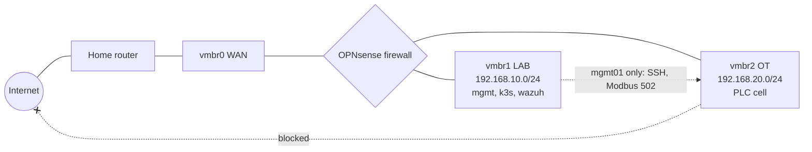

# Home Lab Setup Guide

This guide takes you from bare hardware to the full platform in this repo:
a segmented lab network, hardened Rocky Linux servers, a k3s cluster with a
signed-image supply chain, monitoring and runtime detection, and an OT cell
with network detection. Plan on about 8 weeks at 8 to 10 hours a week for the core lab, plus 3 weeks for the AI module (about 4 to 5 months at 1 hour a day).

Work through the steps in order. Each one ends with a **Proof** item: a
screenshot or file to save in `docs/evidence/`. That folder is what turns
"I built a lab" into something a hiring manager can verify.

---

## 1. Choose your hardware

| Option | What you need | Good for |
|---|---|---|
| **A. Mini PC (recommended)** | Used business mini PC (Lenovo ThinkCentre Tiny, Dell OptiPlex Micro, HP EliteDesk Mini) with 8th-gen Intel or newer, **32 GB RAM**, 500 GB+ SSD | The whole lab, running 24/7, quietly |
| **B. Your current PC** | 16 GB RAM minimum, VT-x/AMD-V enabled in BIOS | Everything except running all VMs at once; run the OT lab and cluster on separate days |
| **C. Cloud only** | AWS account with the budget alarm in `terraform/aws/` | Skips segmentation and the OT network; least impressive, costs money monthly |

Upgrade path: add a second mini PC later and make it a Proxmox cluster node.
That is a strong talking point for Linux engineer interviews.

### VM plan (Option A)

| VM | Network | vCPU | RAM | Disk | Purpose |
|---|---|---|---|---|---|
| `opnsense` | WAN + LAB + OT | 2 | 2 GB | 16 GB | Firewall and router between segments |
| `mgmt01` | LAB 192.168.10.10 | 2 | 2 GB | 20 GB | Ansible, Terraform, kubectl, helm (your control node) |
| `k3s-cp01` | LAB 192.168.10.21 | 2 | 6 GB | 40 GB | Kubernetes server |
| `k3s-wk01` | LAB 192.168.10.22 | 2 | 6 GB | 40 GB | Kubernetes worker |
| `otlab01` | OT 192.168.20.30 | 2 | 3 GB | 20 GB | Docker host for the PLC/HMI/Zeek cell |
| `wazuh` (stretch) | LAB 192.168.10.40 | 4 | 8 GB | 60 GB | SIEM for all hosts |

For the AI module (section 12), raise `k3s-wk01` to 10 GB RAM, or pause the OT lab VM while testing.

Total without Wazuh: about 19 GB RAM, which leaves Proxmox comfortable headroom on 32 GB.

---

## 2. Network design: segmentation you can explain



Firewall rules on OPNsense (this is the Purdue-model segmentation you did at Flora, in miniature):

| # | Source | Destination | Port | Action | Why |
|---|---|---|---|---|---|
| 1 | LAB net | any | any | Allow | Servers need updates and registries |
| 2 | mgmt01 | OT net | 22, 502 | Allow | Engineering access from one jump host only |
| 3 | OT net | LAB net | any | Block + log | OT may never initiate into IT |
| 4 | OT net | any | any | Block + log | OT has no internet (air-gap style) |
| 5 | Your workstation IP (WAN side) | LAB net | 22, 80, 443, 6443 | Allow | You manage the lab from your own PC |
| 6 | WAN | any | any | Block | Nothing else reaches the lab |

**Reaching the lab from your PC.** Your PC sits on the home network, outside
the firewall. Add a static route so it sends lab traffic to OPNsense's WAN
address (shown on the OPNsense console, e.g. `192.168.1.60`):

```bash
# Windows (admin PowerShell)
route -p add 192.168.10.0 mask 255.255.255.0 192.168.1.60
# macOS
sudo route -n add -net 192.168.10.0/24 192.168.1.60
# Linux
sudo ip route add 192.168.10.0/24 via 192.168.1.60
```

For package installs on `otlab01`, temporarily enable a rule allowing it out on
443, then disable it. Write that as a change record in `docs/evidence/`:
it mirrors how you patch air-gapped OT at work.

**Proof:** screenshot of the OPNsense rules page and a blocked-traffic log entry.

---

## 3. Install Proxmox VE

1. Download the Proxmox VE ISO from proxmox.com and write it to a USB stick with Rufus, Etcher or Ventoy.
2. Boot the mini PC from USB and install. Give the host a static IP on your home network, e.g. `192.168.1.50`.
3. Browse to `https://192.168.1.50:8006` and log in as root.
4. In a shell on the host, switch to the free update repository and patch:

```bash
# Proxmox 8 / Debian 12 shown; adjust "bookworm" if your version differs.
sed -i 's/^deb/#deb/' /etc/apt/sources.list.d/pve-enterprise.list
echo "deb http://download.proxmox.com/debian/pve bookworm pve-no-subscription" \
  > /etc/apt/sources.list.d/pve-no-subscription.list
apt update && apt -y full-upgrade
```

5. Turn on MFA for root (Datacenter > Permissions > Two Factor), and create a non-root admin user for daily use.

### Create the lab bridges

Datacenter > your node > System > Network > Create > Linux Bridge, twice:

- `vmbr1`, no IP, no bridge ports, comment `LAB`
- `vmbr2`, no IP, no bridge ports, comment `OT`

Click **Apply Configuration**. These bridges have no physical port, so the only
way in or out is through the firewall VM.

**Proof:** screenshot of the network page with the three bridges.

---

## 4. Install the OPNsense firewall

1. Upload the OPNsense DVD ISO to Proxmox (local > ISO Images).
2. Create VM `opnsense` with three network devices: `vmbr0`, `vmbr1`, `vmbr2` (VirtIO).
3. Install, then assign interfaces: WAN = vtnet0 (DHCP from home router), LAN = vtnet1 `192.168.10.1/24`, OPT1 (rename to OT) = vtnet2 `192.168.20.1/24`.
4. Enable the DHCP server on LAB and OT for convenience, but you will pin the server IPs statically.
5. Add the rules from the table in section 2. Enable logging on every block rule.
6. Because WAN sits on your home network (a private range), uncheck **Block private networks** on the WAN interface.

---

## 5. Build a Rocky Linux 9 template, then clone the servers

Make an SSH key on the computer you will work from:

```bash
ssh-keygen -t ed25519 -f ~/.ssh/lab_ed25519 -C "homelab"
```

Copy `~/.ssh/lab_ed25519.pub` to the Proxmox host, then on the host:

```bash
cd /var/lib/vz/template
wget https://dl.rockylinux.org/pub/rocky/9/images/x86_64/Rocky-9-GenericCloud-Base.latest.x86_64.qcow2

qm create 9000 --name rocky9-template --memory 2048 --cores 2 \
  --net0 virtio,bridge=vmbr1 --scsihw virtio-scsi-pci --agent enabled=1
qm importdisk 9000 Rocky-9-GenericCloud-Base.latest.x86_64.qcow2 local-lvm
qm set 9000 --scsi0 local-lvm:vm-9000-disk-0 --ide2 local-lvm:cloudinit \
  --boot order=scsi0 --serial0 socket --vga serial0
qm set 9000 --ciuser labadmin --sshkeys /root/lab_ed25519.pub
qm template 9000
```

Clone one VM per row of the VM plan. Example for the control node and cluster:

```bash
clone() {  # id name ip bridge disk_gb ram_mb
  qm clone 9000 "$1" --name "$2" --full
  qm set "$1" --net0 "virtio,bridge=$4" --memory "$6" \
    --ipconfig0 "ip=$3/24,gw=${3%.*}.1" --nameserver "${3%.*}.1"
  qm resize "$1" scsi0 "${5}G"
  qm start "$1"
}
clone 110 mgmt01   192.168.10.10 vmbr1 20 2048
clone 121 k3s-cp01 192.168.10.21 vmbr1 40 6144
clone 122 k3s-wk01 192.168.10.22 vmbr1 40 6144
clone 130 otlab01  192.168.20.30 vmbr2 20 3072
```

Test: `ssh -i ~/.ssh/lab_ed25519 labadmin@192.168.10.10`.

---

## 6. Set up the control node and harden every server

On `mgmt01`:

```bash
sudo dnf -y install ansible-core git python3-pip
sudo dnf config-manager --add-repo https://rpm.releases.hashicorp.com/RHEL/hashicorp.repo
sudo dnf -y install terraform
curl -fsSL https://raw.githubusercontent.com/helm/helm/main/scripts/get-helm-3 | bash
curl -LO "https://dl.k8s.io/release/$(curl -Ls https://dl.k8s.io/release/stable.txt)/bin/linux/amd64/kubectl"
sudo install -m 0755 kubectl /usr/local/bin/ && rm kubectl
```

Copy your private key to `mgmt01:~/.ssh/lab_ed25519`, clone your repo (step 7), then:

```bash
cd devsecops-secure-platform/ansible
cp inventory/hosts.example.ini inventory/hosts.ini
ansible-galaxy collection install -r requirements.yml
ansible all -m ping                       # every host answers "pong"

ansible-playbook compliance.yml           # BEFORE score
ansible-playbook site.yml --check --diff  # preview the changes
ansible-playbook site.yml                 # harden + install k3s
ansible-playbook compliance.yml           # AFTER score
```

Write both scores in the README results table. A stock Rocky image typically
scores far lower than a hardened one; the exact jump is your number to report.

Copy the kubeconfig to `mgmt01` and point it at the server:

```bash
scp labadmin@192.168.10.21:.kube/config ~/.kube/config
sed -i 's/127.0.0.1/192.168.10.21/' ~/.kube/config
kubectl get nodes   # both nodes Ready
```

**Proof:** the two OpenSCAP HTML reports from `ansible/reports/`, and `kubectl get nodes` output.

---

## 7. Put the project on GitHub

1. Create a **public** repository on GitHub named `devsecops-secure-platform`.
2. Replace the placeholders with your GitHub username (keep the lowercase one lowercase):

```bash
GH_USER=YourGitHubName
grep -rl "YourGitHubName" . | xargs sed -i "s/YourGitHubName/$GH_USER/g"
grep -rl "yourgithubname" . | xargs sed -i "s/yourgithubname/${GH_USER,,}/g"
```

3. Push:

```bash
git init -b main && git add . && git commit -m "Initial platform"
git remote add origin https://github.com/$GH_USER/devsecops-secure-platform.git
git push -u origin main
```

4. In the repo: **Settings > Actions > General > Workflow permissions** = Read and write (the deploy job commits the signed digest).
5. **Settings > Code security**: turn on Dependabot alerts and secret scanning push protection.
6. **Settings > Branches**: protect `main`, require pull requests and the `ci` checks to pass.
7. Watch **Actions**. When the first `ci` run on main finishes, open **Packages > secure-app > Package settings** and set visibility to Public so the cluster can pull it.

**Proof:** screenshot of a green pipeline run, and of the Security tab showing the scan results.

---

## 8. Install the platform layer on the cluster

From `mgmt01`, in the repo root:

```bash
./scripts/bootstrap-cluster.sh
```

That installs Kyverno, Prometheus/Grafana, Falco and Argo CD, then points
Argo CD at `k8s/app` and `k8s/policies`. Add these to the hosts file on your
own computer so the ingress names resolve:

```
192.168.10.21  secure-app.lab  grafana.lab
```

Verify:

- `http://secure-app.lab/api/info` shows the commit SHA of your latest build.
- Argo CD shows both applications **Synced / Healthy**.
- Grafana shows the cluster dashboards.

**Proof:** screenshots of Argo CD and Grafana, plus the `/api/info` response.

---

## 9. Run the OT detection lab

On `otlab01` (temporarily allow it out on 443 at the firewall, as a logged change):

```bash
sudo dnf -y install dnf-plugins-core
sudo dnf config-manager --add-repo https://download.docker.com/linux/rhel/docker-ce.repo
sudo dnf -y install docker-ce docker-ce-cli containerd.io docker-compose-plugin
sudo systemctl enable --now docker
sudo usermod -aG docker labadmin   # log out and back in
```

Copy the `ot-lab/` folder over (`scp -r` from `mgmt01`), close the firewall
rule again, then:

```bash
cd ot-lab
docker compose up -d --build
docker compose logs -f hmi        # level, setpoint and alarm limit every 2 s
```

In a second terminal, run the attack and watch the detection:

```bash
docker compose --profile attack run --rm rogue
docker compose logs plc | tail    # HIGH LEVEL ALARM never fires; tank heads for 100%
jq -c '{note, msg}' zeek-logs/notice.log   # Unauthorized_Modbus_Write + Safety_Limit_Changed
```

Zeek writes JSON logs (`sudo dnf -y install jq` to read them). Notice that
the engineering workstation's writes (172.30.0.30) appear in `modbus.log` but raise no notice: that is your allow-list working.

**Proof:** `notice.log` lines and the PLC log showing the overflow.

---

## 10. Repeat the core in AWS (optional, about one weekend)

This shows the same design works in the cloud. Do it after the home lab works.

1. Secure the AWS account first: MFA on root, then a separate admin user through IAM Identity Center. Never use root day to day.
2. Install the AWS CLI and the Session Manager plugin, and log in with `aws configure sso`.
3. Apply:

```bash
cd terraform/aws
cp terraform.tfvars.example terraform.tfvars   # fill in your values
terraform init && terraform plan && terraform apply
$(terraform output -raw connect_command)       # shell on the node, no SSH
```

4. When you are done for the day, set `create_node = false` and apply again,
   or run `terraform destroy`. The node is the main cost; the budget alarm
   emails you before spend passes your limit.

**Proof:** `terraform plan` output and a screenshot of the Session Manager shell.

---

## 11. Run the incident drills

Work through `docs/INCIDENT-DRILL.md`. Each drill triggers a control and
captures evidence. Those four write-ups are the stories you tell in interviews.

---

## 12. Add the AI-ops module

Once everything above works, follow **[AI-OPS.md](AI-OPS.md)**: a local
language model triages Falco and Zeek alerts, and Event-Driven Ansible
carries out the response after you approve it. Budget 3 to 4 weeks at
1 hour a day.

**Proof:** an incident's AI summary, your approval, the evidence folder, and the red-team table.

---

## Schedule: 8 weeks core + 3 weeks AI (at 8–10 hours a week)

| Week | Goal | Done when |
|---|---|---|
| 1 | Hardware, Proxmox, bridges, OPNsense | Lab VMs can reach the internet; OT cannot |
| 2 | Rocky template, clone VMs, `mgmt01` tools | `ansible all -m ping` succeeds |
| 3 | CIS hardening with before/after OpenSCAP | Both reports saved, score in README |
| 4 | k3s via Ansible, repo on GitHub, first green pipeline | Signed image in GHCR |
| 5 | Kyverno, Argo CD, monitoring, Falco | App deploys from Git; policies enforced |
| 6 | OT lab and Zeek detection | `notice.log` shows the attack |
| 7 | Incident drills, threat model, AWS run | Four drill write-ups with evidence |
| 8 | Polish README, record a 5-minute demo video, LinkedIn post | Repo link on resume and LinkedIn |
| 9–10 | AI-ops module: Ollama, triage service, EDA, approvals | An approved quarantine with evidence |
| 11 | Red team the AI, add it to the demo video | Red-team table saved |

**At 1 hour a day** the same plan takes about 4 to 5 months: roughly 3 to 4
months for weeks 1 to 8 and 3 to 4 more weeks for the AI module. Save the
long steps (Proxmox install, first cluster build) for weekends. Start
applying once week 4 is done and the pipeline is green.

While you build, study for the **Terraform Associate** (weeks 1 to 4) and
the **CKA** (weeks 5 to 12). The lab doubles as your exam practice.

---

## Troubleshooting

| Symptom | Likely cause | Fix |
|---|---|---|
| Cloned VM has no network | Wrong bridge or gateway | `qm config <id>`; gateway must be `.1` of that segment |
| SSH refused after hardening | User not in `wheel` | The role adds `ansible_user` to `wheel`; for others, add them before running |
| k3s pods stuck `ContainerCreating` | firewalld blocking pod network | Re-run `site.yml`; the k3s role trusts `10.42.0.0/16` and `10.43.0.0/16` |
| Pod rejected: "signature" | Image not signed by your workflow | Check the subject in `verify-image-signatures.yaml` matches your repo exactly |
| Pod rejected: ":latest" | CI has not pinned a digest yet | Wait for the first `deploy` job to commit the digest |
| Argo CD `ImagePullBackOff` | GHCR package is private | Make the package public (step 7.7) |
| Zeek writes no `modbus.log` | No traffic or wrong interface | `docker compose exec zeek ip a`; interface must be `eth0` |
| Audit rule changes ignored | Rules are immutable (`-e 2`) | Reboot the host |
