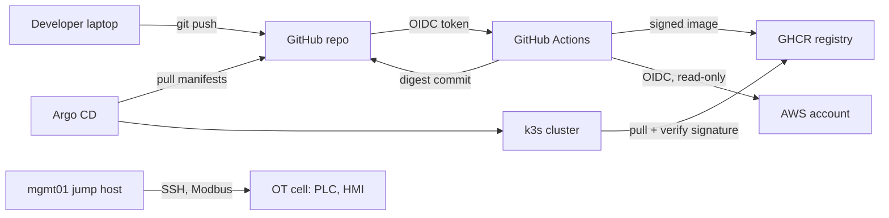

# Threat Model

Method: STRIDE per asset, then each threat mapped to the control in this
repo that mitigates it. Review this file whenever the architecture changes.

## Assets and trust boundaries

Trust boundaries: (1) internet to GitHub, (2) CI to registry and AWS,
(3) registry to cluster admission, (4) LAB network to OT network,
(5) alert data to the language model, and model output to automation.

## Threats and controls

| # | Asset | STRIDE | Threat | Control in this repo | Residual risk |
|---|---|---|---|---|---|
| 1 | Source code | Info disclosure | Credentials committed to Git | Gitleaks gate in `ci.yml`; GitHub push protection | Secrets in history before the gate existed |
| 2 | Source code | Tampering | Vulnerable code merged | Semgrep SAST gate; branch protection requires PR + green CI | Logic flaws SAST cannot see |
| 3 | Dependencies | Tampering | Vulnerable or malicious package | Trivy image scan fails on fixable HIGH/CRITICAL; Dependabot updates | Zero-days; unfixed CVEs are reported, not blocked |
| 4 | CI pipeline | Elevation | Compromised third-party action | Least-privilege `permissions:` per job; Dependabot for actions | Actions pinned by tag, not SHA (next step: pin SHAs) |
| 5 | AWS account | Spoofing | Stolen long-lived access keys | GitHub OIDC federation, no static keys; trust scoped to this repo's main branch and PRs | A compromised maintainer account |
| 6 | AWS account | Elevation | CI changes infrastructure without review | CI role is ReadOnlyAccess; apply only runs locally after review | Manual apply mistakes |
| 7 | Container image | Tampering | Image swapped in registry or built off-pipeline | Cosign keyless signing; Kyverno admits only images signed by this workflow on main, pinned by digest | Sigstore service outage blocks deploys (fail closed) |
| 8 | Container image | Repudiation | Unknown contents of a running image | SPDX SBOM attested to every image | — |
| 9 | Cluster workloads | Elevation | Container escape via privileged pod or root user | Pod Security Admission `restricted`; Kyverno non-root, no-privileged, limits; read-only root FS; all capabilities dropped | Kernel vulnerabilities |
| 10 | Cluster workloads | Info disclosure | Lateral movement between pods | Default-deny NetworkPolicy; only ingress controller and Prometheus allowed in | — |
| 11 | Cluster workloads | Tampering | Attacker shell or tooling in a running pod | Falco rules for shells, package managers, outbound connections | Detection, not prevention: needs a response |
| 12 | Cluster state | Tampering | Manual `kubectl` drift | Argo CD self-heal reverts out-of-Git changes | Cluster-admin can disable Argo CD |
| 13 | Linux hosts | Elevation | Weak SSH, unpatched packages | CIS L1 hardening: key-only SSH, wheel-only login, auto security updates, SELinux enforcing | Local privilege-escalation zero-days |
| 14 | Linux hosts | Repudiation | Changes without a trail | auditd CIS rules (immutable), AIDE daily integrity check | Logs live on the host until a SIEM is added |
| 15 | EC2 node | Info disclosure | SSRF steals instance credentials | IMDSv2 required; no inbound ports; SSM-only access | — |
| 16 | OT cell | Spoofing / Tampering | Unauthenticated Modbus writes change setpoints or safety limits | Firewall: OT reachable only from `mgmt01`; Zeek alerts on writes from non-allow-listed hosts and on safety-register changes | Modbus has no auth; an attacker on `mgmt01` looks legitimate |
| 17 | OT cell | Denial of service | Internet-borne malware reaches PLC network | OT segment has no internet route; OT cannot initiate into LAB | Removable media, vendor laptops |
| 18 | AI triage | Tampering | Prompt injection through attacker-controlled alert text makes the model dismiss or misroute an incident | Alert text fenced and cleaned; schema-constrained output; severity floor; no dismissal of high-severity alerts; red-team script | The model's written summary can still be misleading; analysts verify against the raw alert |
| 19 | AI triage | Elevation | Model output used to run commands or pick targets | Model chooses from 4 allow-listed runbooks only; targets come from validated alert fields; playbooks re-validate; platform namespaces and PLC/HMI/eng-ws are never targets | A bug in the validation code |
| 20 | AI triage | Spoofing | Forged alerts or approvals | Separate bearer tokens for ingest, approval and the EDA webhook; NetworkPolicy limits who reaches the service and the webhook | Shared tokens are not personal identities (next step: SSO) |
| 21 | AI triage | Denial of service | Model down or overloaded hides alerts | Incident is always created first; failures fall back to evidence collection plus human review; alerts on model failure | A slow model delays recommendations, not detection |
| 22 | Model supply chain | Tampering | Malicious model or model-server image | Pinned Ollama version; model pulled from the official registry once onto a dedicated volume; model server has no access to the lab networks | Image pinned by tag, not digest (next step) |

## Next improvements (backlog)

- Pin every GitHub Action to a full commit SHA.
- Ship host and Falco logs to Wazuh or Loki so evidence leaves the host.
- Add a Modbus-aware allow-list at the firewall (deep packet inspection) in front of the PLC.
- Move Terraform state to S3 with encryption and locking, and enable the CI plan job.
